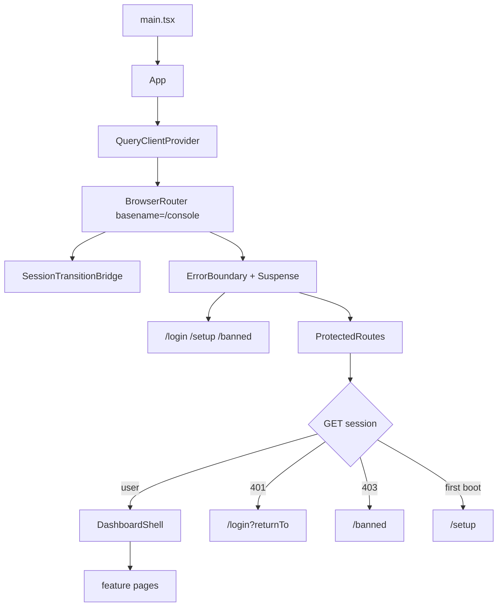
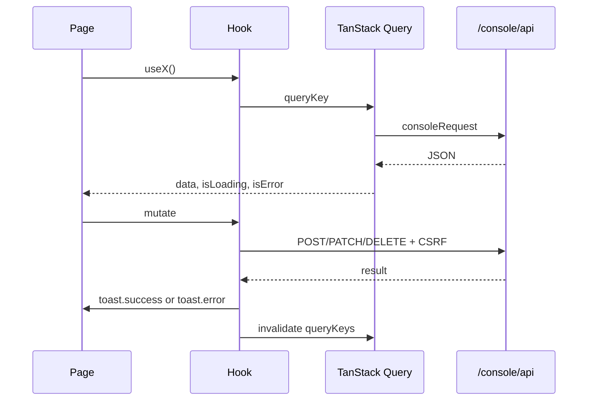

# Dashboard

`dashboard/src/` is the browser app. It is React, React Router, and TanStack
Query. The backend serves the built files at `/console`. The console router
basename is `/console`, so a route written as `/usage` is `/console/usage` in
the browser. Console pages use `/console/api`; the public landing and share apps
use their own public surfaces.

The dashboard does not import Elysia, database drivers, filesystem modules, or
secrets at runtime. Console requests go through `dashboard/src/data/api.ts`;
shared backend contracts may be imported as types only.

## Shell



`ProtectedRoutes` fetches the session once, into `queryKeys.session.current`.
A later page reads that cache. It does not send a second session request on
every navigation. A 401 clears the cache and returns to login with the current
path. A 403 goes to `/banned`.

Route chunks are `lazyWithRetry`. After a deploy the old chunk URL 404s. The
loader reloads once to pick up the new `index.html`, then stops. It does not
loop.

## Pages

| Path | Page | What it operates |
| --- | --- | --- |
| `/` | `OverviewPage` | Tenant health and the first-look summary |
| `/usage` | `UsagePage` | Usage totals, breakdowns and the traffic chart, read from the per-day index (`<day>.index.json`) rather than from the request files; only the request list and its detail drawer read the events, backwards from the file's tail. The first tile on the Routing Latency bar is **Resolve** (average arrival → just-before-upstream: credential, admission, pool slot, preparation), separate from the P50/P95/P99 response-latency series beside it. Each tile's hover tooltip names the window and the sample count that fed it. |
| `/providers` | `ProvidersPage` | Provider catalog |
| `/providers/:providerId` | `ProviderDetailPage` | Accounts, auth, routing (including Usage floor), models |
| `/combos` | `CombosPage` | Aliases and combos |
| `/quota` | `QuotaPage` | Provider quota windows |
| `/proxy` | `ProxyPage` | Network pools and egress |
| `/console-log` | `ConsoleLogPage` | Process log ring. A request row reads left to right across the full width and wraps on its own; it leads with `[REQUEST]`, `[SUCCESS]`, or `[FAILED]`. Nothing is truncated. Newest lines stay at the top, so the view does not stick to the bottom. |
| `/model-lab` | `StudioPage` | Studio sessions against the gateway |
| `/cli-tools` | `CliToolsPage` | CLI tool list |
| `/cli-tools/:toolId` | `CliToolDetailPage` | Per-key slot mappings |
| `/customization` | `CustomizationPage` | Browser-only `localStorage` settings and the IndexedDB background blob; no backend |
| `/settings` | `SettingsPage` | Runtime preferences, backup |
| `/login`, `/setup`, `/banned` | session pages | No shell |

Unknown protected paths redirect to `/`. There is no fusion page.

Three of those pages are backed by a feature page that owns the data and the
console domain behind them: [`/combos`](../../../documentation/features/02-routing-aliases-combos.md),
[`/proxy`](../../../documentation/features/03-network-pools.md), and `/cli-tools`
([CLI model mapping](../../../documentation/features/01-cli-model-mapping.md)). The share page is public
and has its own: [share keys](../../../documentation/features/05-share-keys.md). Provider detail's
quota threshold is documented in [Usage floor](../../../documentation/features/04-usage-floor.md).

## Data flow



`dashboard/src/data/query-keys.ts` is the key tree. A mutation invalidates the
keys it changed. It does not write the server response over an unrelated cache
entry.

`query-client.ts` holds the shared client. `query-policy.ts` holds stale times.
`route-prefetch.ts` warms the next page's queries. `contracts.ts` is the
TypeScript shape of the JSON. If the console payload changes, this file changes
with it. The dashboard does not keep a second, drifted type.

`consoleRequest` attaches the CSRF header on mutations. A 401 or 403 notifies
`SessionTransitionBridge` through `setSessionTransitionListener`.

## Feature layout

| Directory | Holds |
| --- | --- |
| `features/session` | Login, setup, banned |
| `features/overview` | Home summary |
| `features/usage` | Usage charts and breakdowns |
| `features/providers` | Provider list |
| `features/provider-detail` | One provider: accounts, routing, models |
| `features/routing` | Combos and aliases |
| `features/quota` | Quota windows |
| `features/proxy` | Pool list and pool detail |
| `features/logs` | Console log |
| `features/studio` | Model lab |
| `features/cli-tools` | CLI tool mappings |
| `features/settings` | Preferences and backup |
| `features/customization` | Appearance, blur, and background; browser state only |
| `apps/landing` | Public landing |
| `apps/share` | Public share page |
| `apps/console` | Console mount |
| `components/` | Shell, dialog, form controls |
| `hooks/` | Query hooks shared by more than one page |
| `lib/` | Toast, lazy retry, formatting |
| `styles/` | Tokens and layout |

A page-specific hook stays next to the page. A hook used by two features moves
to `dashboard/src/hooks/`.

Model Lab's Chat settings persist tool permission per session. **Ask before
running** is the default and shows an inline approval prompt before web search
or media-generation tools run; **YOLO** runs those tools automatically.
`ask_user_question` remains a separate user-answer flow in either mode.

## Share and landing

`apps/share` is the public page a share link opens: it reads the share API,
lets recipients copy granted model ids and test allowed models with the shared
key, and carries no key-management controls such as enable, disable, or delete.
What the page is for, and what enforces it, is on the
[share keys](../../../documentation/features/05-share-keys.md) page.

`apps/landing` is the unauthenticated product page. Crawlers do not run the
bundle, so title, description, and social tags for landing, console, and share
are injected by `src/console/dashboard-assets.ts` into the one
`dashboard/index.html`. Do not add a second Vite HTML entry.

## Layout rules

The document is the page scroll container. The sidebar rail/navigation and
contained surfaces such as dialogs can scroll independently. `.app-topbar` and
the desktop `.app-sidebar` stick against the document at the shell's 16px inset;
the narrow-shell drawer is fixed. The topbar is an opaque sibling above the
page content with its own shadow.
`.app-main-column`, `.dashboard-page`, and `.route-enter` do not scroll. The
sidebar collapses to a drawer at the shell's `@container app-shell` 860px
threshold, not a viewport breakpoint. `route-enter` moves vertically; do not
add opacity, transform, or filter animation there because it changes the
backdrop-filter grouping used by cards.

Card blur only reaches the uploaded background when that image is painted behind the card in the same group. `BackgroundLayer` mounts inside `.app-main-column`. `.route-enter` animates position only — an `opacity`, `transform`, or `filter` animation groups the page, and the card then blurs the black body instead of the image. `.custom-background` keeps `contain: none` for the same reason; anything else also pins a `fixed` layer to the scroller. Clarity and blur are separate sliders.

Dialog sizes come from `DialogSize` (`sm` 420, `md` 640, `lg` 880, `xl` 960) in
`components/ui/dialog.tsx`; `size` wins over `width`, and a raw `width={…}` px is
legacy. `expanded` is the explicit full-width escape hatch and caps at 1160. At
`max-small` (640px) a dialog stays centered with reduced viewport margins;
`Drawer` is the surface that becomes a full-viewport panel. New dialogs use
`DialogSize`, not a raw width.

New persisted UI preferences should use a `cartethyia:<area>:<name>` key and
defensive reads (SSR/storage availability, validation, and a fallback). Some
existing preferences retain older key formats; follow the owning helper rather
than renaming persisted keys incidentally. The share page stores an issued
enrollment key in IndexedDB, keyed by the share token.

Polling lists sort with a deterministic tiebreaker. Two rows with the same
timestamp must not swap places between polls.

## Mutation feedback

Every mutation toasts both arms.

| Result | Toast |
| --- | --- |
| success | `toast.success` with the outcome, for example "Proxy pool created" |
| failure | `toast.error` with `getErrorMessage(error, ...)` |

A `mutate` that reports neither is a bug. The operator cannot tell whether the
click landed.

## Provider routing controls

`useRoutingStrategy` reads provider routing and writes it back through
`useUpdateProviderRouting`. Round robin is a boolean over the `round_robin`
strategy; fallback is the other value. `rotateCount`, `maxInflight`,
`skipProxy`, and `userAgent` save through `useDebouncedSave`, so a slider does
not send one request per pixel. User-agent editing is gated by `allowUserAgent`.

Three defaults apply when no routing row exists, all read from the backend:

- **Cline skips the proxy.** Its health follows the egress address, so a pool in
  front of it is the thing most likely to be wrong.
- **`maxInflight` is unlimited.** It was 5, which capped every unconfigured
  provider and surfaced as `capacity_exhausted` — a limit nobody set. A ceiling
  the operator did set is still enforced.
- **Client identity is the Claude Code CLI**, on the live version. It was a
  frozen Codex literal. "None" still means no header, which is why the hook
  initializes `userAgent` to `""` and lets the fetched row fill it.

## Build and serve

`bun run dashboard:build` writes the static bundle. The backend serves it. The
dev server proxies `/console/api` to the gateway. A page that works in dev and
404s in production is almost always a basename or asset-path mistake, not a
data bug.

Social tags are verified on the served HTML, not in the React tree. The served
document for `/`, a console route, and a share route must each carry the tags
`dashboard-assets.ts` injects.

## Authenticated console session

The console needs a sign-in, and the credential is an operator password. One
command does the whole thing:

```bash
bun run dev:console-auth
```

It reads `CARTETHYIA_DEV_ADMIN_USER` (default `admin`) and
`CARTETHYIA_DEV_ADMIN_PASSWORD`, signs in through the **real form on the real
route**, and exits non-zero naming what is missing when either the stack is down
or the password is unset. Nothing secret is printed — no password, no session
token.

Afterwards, plain `agent-browser` commands share the same browser and are
already signed in, so the rest of the verification is ordinary CLI work:

```bash
agent-browser eval "!!document.querySelector('button[aria-label=\"Sign out\"]')"
```

Three things worth knowing before it looks broken:

- **It deliberately uses the CLI's default session**, not a named one, and no
  `--idle-timeout`. Each `--session` is an isolated browser with its own
  cookies, so a named session would leave the agent's own unfangled commands
  signed out; the CLI's default idle timeout is one hour, which is what an
  interactive session wants. (`scripts/test/visual-baseline.ts` does the opposite
  on purpose — it owns its browser start to finish.)
- **A fresh dev database lands on `/console/setup`, not `/console/login`**, and
  the wizard is the only real way an account comes to exist. `signInToConsole`
  in `scripts/test/console-auth.ts` resolves all three terminal states
  (`setup` / `login` / already-`shell`), which is why re-running the command is
  safe and a no-op.
- **5173 serves `dashboard/src` with HMR; 12800 serves the built bundle** from
  `dist/dashboard` and needs `bun run dashboard:build` after an edit. The
  command defaults to 5173 and takes an origin argument for the other.

Sign-in, credential resolution, and the `agent-browser` CLI plumbing live in
`scripts/test/console-auth.ts`, shared with `visual-baseline.ts` so there is one
implementation. No production code is touched and no auth gate is weakened: it
is the same form an operator fills, reached with a credential from the
environment.

## Styling migration

The dashboard styling uses one dialect — token → utility → primitive.
The current inventory:

- CSS is three files: `styles/tokens.css` (tokens), `styles/base.css`
  (reset/elements), `styles/app.css` (irreducible + shell frame). The old
  `console.css`, `landing.css`, and `share.css` are dissolved into utilities and
  components.
- Repeated visuals become `components/ui/` atoms or `components/patterns/`
  blocks. A page composes them; it does not restyle them.

Order of work, so a step never lands blind:

1. `dashboard/test/style-guard.test.ts` + `dashboard/style-guard.json` hold the ratchet.
2. `scripts/test/visual-baseline.ts` covers the landing page and a selected set
   of public and authenticated console routes (not every dashboard route): it builds the
   dashboard, boots the real gateway (serving the built dist and `/console/api`
   on one origin), signs in through the real form (`admin`; password from
   `CARTETHYIA_DEV_ADMIN_PASSWORD`), and measures through the browser agent
   (`agent-browser`, not a hand-rolled CDP client). Live-by-nature answers are
   stubbed at the browser so they cannot drift a comparison: `/system/health`,
   `/updates/release`, the `/system/usage/*` and `/quota/overview` telemetry, the
   `/logs` snapshot+stream, and the discovery-derived fields of
   `/console/api/providers` (`clientVersion`, `routeIdentityVersions`) that the
   background npm/PyPI monitor fills. Client-side non-determinism is pinned by
   an init script too:
   - `Math.random` is pinned to **one fixed draw**, not a sequence. The Model Lab
     draws its session name twice — once in the `useState` initializer and again
     when IndexedDB hydration replaces the session — so a sequence still lets the
     chip's title change width mid-load, and when both names are the same length
     the document's text length is unchanged and `settle` cannot see the swap.
   - `Date.now` is pinned to a fixed instant (React Query's `dataUpdatedAt`,
     which the Quota page renders as a `HH:MM` stamp). This is a client clock, so
     no response stub can pin it.
   - The landing and share pages load star/fork counts as live-width images from
     the badge host; their `src` is rewritten to a fixed-size local `data:` SVG
     before the element is created (CSP already admits `data:` in `img-src`).
     They arrive as images, so they are invisible to the in-flight `fetch`
     counter that `settle` waits on.
   Everything else stays live.
3. Build or revise the `ui/` atom, then the `patterns/` block, before the pages
   that use it.
4. Migrate one page per commit, worst-first; lower its `style-guard.json` entry
   in the same commit.

Verification per step: `bun run dashboard:typecheck`, `bun run dashboard:test`,
and `CARTETHYIA_DEV_ADMIN_PASSWORD=… bun scripts/test/visual-baseline.ts
compare` (which must stay green while a step only re-expresses styling, and is
re-captured in the scale-normalization step that intentionally changes pixels).

That script reads `CARTETHYIA_DEV_ADMIN_PASSWORD` (required), plus
`CARTETHYIA_DEV_ADMIN_USER`, `CARTETHYIA_VISUAL_PORT`, and
`CARTETHYIA_BROWSER_AGENT` when set. They are dev-tooling only — no runtime
path reads them, so they are absent from `CONFIG_SPEC` and
`documentation/reference/configuration.md` — and are listed in `.env.example`
under "Dev console admin". The password is an operator credential; handling it
follows `AGENTS.md` "Safety and git" — it may arrive in a message, and it never
goes into a file, a commit, or output.

`agent-browser` is what UI claims about layout, computed style, focus, and
overflow are measured through, including this script's own measurements. A
page can also be measured by driving the CLI directly, which is the normal path
when no gateway credential is available.

## Where to change what

| Change | Start here |
| --- | --- |
| New page | `App.tsx` route, feature directory, query key, console domain |
| New API field | console contract, then `data/contracts.ts`, then the hook |
| New dialog | `components/` dialog, `DialogSize`, both toast arms |
| Share page behavior | `apps/share`, and the share API it reads |
| Layout | `dashboard/src/styles/` and `dashboard/src/apps/console/shell.tsx` |
